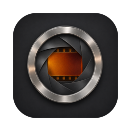
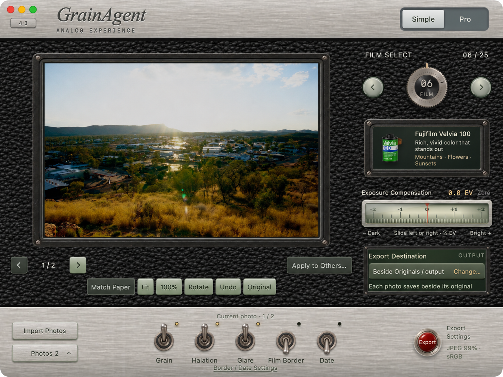
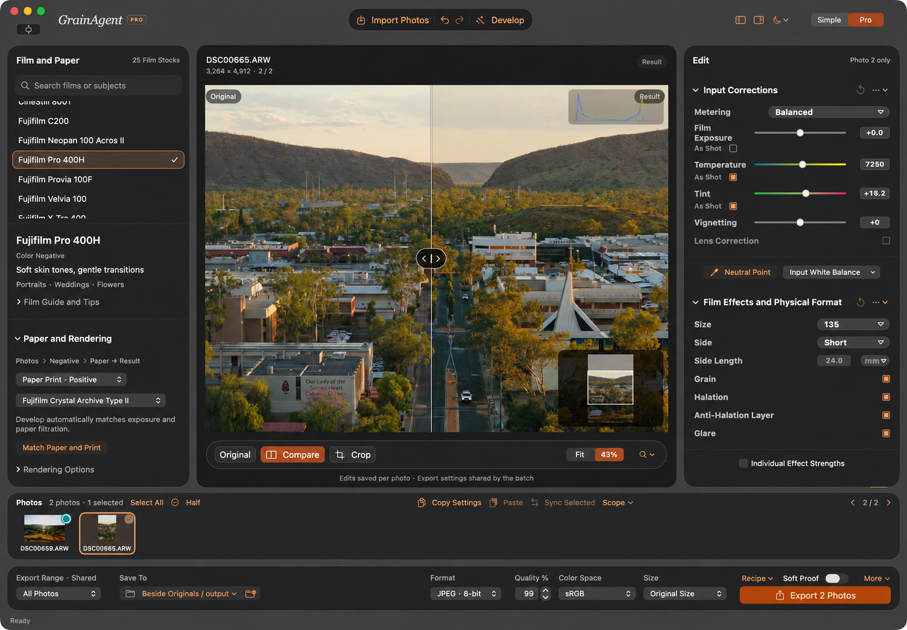

<h1 align="center">GrainAgent</h1>

<strong>Give your photos a film-inspired look.</strong> A photo editor for Mac that brings film colour, grain and photographic paper together — with simple camera controls or a precise professional workspace.

<a href="https://github.com/RichardCarolJ/GrainAgent/releases/download/v1.0.1/GrainAgent-1.0.1-build29-macOS-arm64.zip"><strong>Download for Mac</strong></a> · <a href="https://github.com/RichardCarolJ/GrainAgent/releases/tag/v1.0.1">Release notes</a> · <a href="README.zh-CN.md">简体中文</a>

**GrainAgent 1.0.1** turns a single photo or a whole shoot into a finished set. Choose a film, shape the look, and export — while keeping your original photos untouched.

| Compatibility | |
| --- | --- |
| Mac | Apple Silicon · M-series chips |
| macOS | **14 Sonoma or later** |
| Languages | English · 简体中文 · Français · Español |

This release is for Apple Silicon Macs. Intel Macs and Windows are not supported.

## The film look starts with exposure

Many filters apply a preset look to a finished photo. GrainAgent models film exposure and development using the selected stock’s sensitivity to different colours of light and the way exposure translates into density as the film develops. For a paper print, it models light from an enlarger passing through the negative and exposing the paper, then uses the paper’s response to exposure and development to form the print.

A different film can give the same photo softer highlights or deeper shadows. A different paper can change the colour and contrast of the finished print.

## Simple mode — choose a film and start creating

Turn the dial to explore **25 film stocks**. Exposure, grain, halation, film borders and date stamps are close at hand, whether you’re editing a single photo or finding a look for a whole shoot.

## Pro mode · Fine-tune your film look

Pair film with photographic paper, refine exposure, white balance, curves and colour, and compare the result with the original. Give each photo its own adjustments or share a look across a set.

Switch between modes and keep working on the same photos. GrainAgent processes photos on your Mac and saves each photo’s edits separately. Export a single photo or a batch while keeping the originals intact.

Showcase photographs by Richard Jin. Interface images are retouched for presentation. [Image credits](docs/SCREENSHOT-CREDITS.md)

The download includes an illustrated guide in English and Simplified Chinese. [Quick-start PDF](docs/GrainAgent-Quick-Start.pdf) · [Version history](CHANGELOG.md) · [First-launch help](https://support.apple.com/en-us/102445)

## Source, licence and acknowledgements

GrainAgent is maintained by **Richard Jin**. The app is based on **SpektraLab 1.3.5** by Hanze Qiu and contributors. Film and paper simulation uses the **spektrafilm** model and data by Andrea Volpato. [SpektraLab](https://github.com/JamesQiu2005/SpektraLab) · [spektrafilm](https://github.com/andreavolpato/spektrafilm)

The application and engine are licensed under **GPL-3.0-or-later**. The spektrafilm film and paper profiles and derived LUTs are licensed under **CC BY-SA 4.0**. [Code licence](LICENSE.txt) · [Full attribution](NOTICE.md) · [Data provenance](license/UPSTREAM-DATA-PROVENANCE.txt)

The corresponding source is included with the app and available as a separate download. [Corresponding source ZIP](https://github.com/RichardCarolJ/GrainAgent/releases/download/v1.0.1/GrainAgent-1.0.1-build29-source.zip) · [Build instructions](DEVELOPMENT.md) · [Report an issue](https://github.com/RichardCarolJ/GrainAgent/issues)
