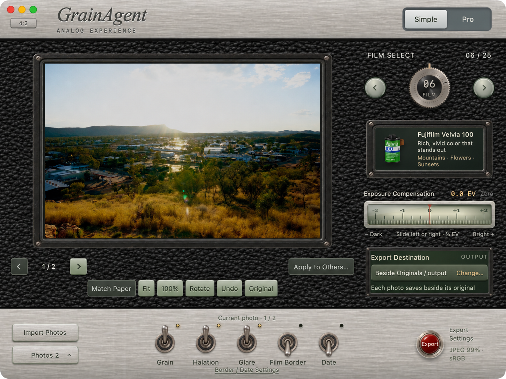

<h1 align="center">GrainAgent</h1>

<strong>让照片，多一点胶片的味道。</strong> 为 Mac 打造的胶片风格照片编辑器。用复古相机般的直觉操作快速出片，也能进入专业工作区，细调每一个画面。

<a href="https://github.com/RichardCarolJ/GrainAgent/releases/download/v1.0.1/GrainAgent-1.0.1-build29-macOS-arm64.zip"><strong>下载 Mac 正式版</strong></a> · <a href="https://github.com/RichardCarolJ/GrainAgent/releases/tag/v1.0.1">发行说明</a> · <a href="README.md">English</a>

**GrainAgent 1.0.1** 将胶片色彩、颗粒、光晕与相纸效果融入数码照片。从一张照片到整组作品，选胶片、调整、导出，在同一个应用里完成，原始照片保持不变。

| 支持范围 | |
| --- | --- |
| 芯片 | Apple Silicon · M 系列 |
| 系统 | **macOS 14 Sonoma 及以上** |
| 界面语言 | 简体中文 · English · Français · Español |

本版适用于 M 系列 Mac，不支持 Intel Mac 或 Windows。

## 胶片的味道，从曝光开始

常见滤镜通常给已经成像的照片应用一套预设色调。GrainAgent 模拟胶片的曝光与显影，根据所选胶片对不同颜色光线的敏感度，以及曝光与影像密度的关系，计算胶片显影后的结果。选择相纸印相时，它再模拟放大机的光穿过负片、让相纸曝光，并根据相纸的感光和显影特性生成成片。

同一张照片，换一款胶片可以让亮部过渡更柔和，也可以让阴影更深沉。换一种相纸，成片的色调和反差也会随之改变。

## 简单模式：选一款胶片，就开始创作

转动胶片拨轮，从 **25 款胶片**中找到喜欢的风格。曝光、颗粒、光晕、片边和日期戳都在手边，适合随手修一张，也适合给一组照片定下基调。

## 专业模式 · 精细调整胶片风格

搭配胶片和相纸，细调曝光、白平衡、曲线和色彩，随时与原图对照。每张照片可以有自己的调整，也可以让一组照片共享喜欢的风格。

可以随时切换模式，继续编辑同一批照片。GrainAgent 在 Mac 上本地处理照片，逐张保存编辑参数。单张和批量导出都保留原片。

展示照片由 Richard Jin 拍摄，界面图经过展示性修饰。[图片署名](docs/SCREENSHOT-CREDITS.md)

下载包附中英双语图文指南。[快速入门 PDF](docs/GrainAgent-Quick-Start.pdf) · [版本历史](CHANGELOG.md) · [首次打开帮助](https://support.apple.com/zh-cn/102445)

## 源码、许可与致谢

GrainAgent 由 **Richard Jin** 维护。应用基于 Hanze Qiu 与贡献者的 **SpektraLab 1.3.5**，胶片与相纸模拟使用 Andrea Volpato 的 **spektrafilm** 模型和数据。[SpektraLab](https://github.com/JamesQiu2005/SpektraLab) · [spektrafilm](https://github.com/andreavolpato/spektrafilm)

应用和引擎代码采用 **GPL-3.0-or-later**。spektrafilm 胶片／相纸数据与衍生 LUT 采用 **CC BY-SA 4.0**。[代码许可](LICENSE.txt) · [完整署名](NOTICE.md) · [数据来源](license/UPSTREAM-DATA-PROVENANCE.txt)

对应源码随应用提供，也可单独下载。[对应源码 ZIP](https://github.com/RichardCarolJ/GrainAgent/releases/download/v1.0.1/GrainAgent-1.0.1-build29-source.zip) · [构建说明](DEVELOPMENT.md) · [反馈问题](https://github.com/RichardCarolJ/GrainAgent/issues)
